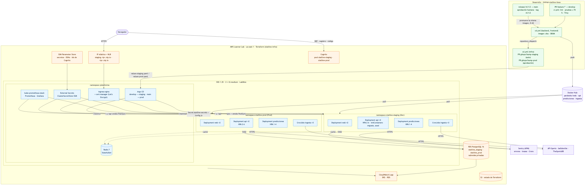

# statline-infra

Infrastructure for **StatLine**, a web platform for unified sports statistics and performance forecasts across three leagues: **NBA** (basketball), **NFL** (American football) and **Liga MX** (football). Scheduled jobs pull games and box scores from API-Sports, a REST API serves comparisons and standings, and a Python service produces match-outcome probabilities and player projections.

This repo holds:
- **Terraform** for every AWS resource (Learner Lab, D-38): `bootstrap` (S3 state bucket, ingress Elastic IP) and `principal` (VPC, EKS, RDS PostgreSQL, SSM parameters, Cognito user pools, CloudWatch logs, platform Helm releases)
- the `make` targets that bootstrap state, plan and apply
- a **k3d** setup for testing the Kubernetes manifests locally
- the **GitOps** charts (`gitops/charts/statline`, `gitops/charts/redis`) and the Argo CD applications that deploy the four images
- the project-wide docs: architecture, data model, API design, backlog and pending work

The app itself lives in [`statline-backend`](https://github.com/statline-iteso/statline-backend) and [`statline-frontend`](https://github.com/statline-iteso/statline-frontend).

## Proyecto final · ITESO, Otoño 2026

**Proyecto:** StatLine — Plataforma de Estadísticas y Pronósticos Deportivos Multideporte

| Integrante | Rol |
|---|---|
| Juan Pablo González | Backend, frontend y cimientos (primera mitad) |
| Ian Rodríguez | Infraestructura, predicciones y despliegue (segunda mitad) |

### Descripción

StatLine reúne en un solo lugar las estadísticas de la NBA, la NFL y la Liga MX y las acompaña de pronósticos. Cada día un CronJob por deporte consulta API-Sports (con balldontlie y TheSportsDB de respaldo), normaliza partidos y líneas de caja, valida las métricas de cada línea contra el JSON Schema de su deporte y las guarda en PostgreSQL (columna JSONB con índice GIN). Un usuario se registra con su correo (Cognito), revisa posiciones y boxscores, compara jugadores, consulta las probabilidades de cada partido que calcula el modelo activo, y arma listas privadas y alertas. Un ADMIN administra el catálogo, las ingestas, los modelos y los roles de los usuarios.

| Ambiente | URL | Rama | Datos |
|---|---|---|---|
| Dev (staging) | `https://staging.<ip>.nip.io` | `develop` | en vivo + demo (D-42) |
| Prod | `https://<ip>.nip.io` | `main` (con aprobación) | solo en vivo (D-46) |

La IP es la IP elástica de la cuenta del lab (`terraform -chdir=terraform/bootstrap output -raw ingress_ip`).

### Componentes y métodos

| Componente | Repo | Tecnología | Qué hace |
|---|---|---|---|
| web | [statline-frontend](https://github.com/statline-iteso/statline-frontend) | React 18, Vite, Tailwind, TanStack Query, Amplify (auth) | SPA: catálogo, boxscores, comparación, pronósticos, listas, alertas, usuarios |
| api | [statline-backend](https://github.com/statline-iteso/statline-backend) `services/api` | Node 20, Express, Prisma | REST `/api/*`, verificación de tokens de Cognito, roles, caché en Redis |
| predicciones | statline-backend `services/predicciones` | Python 3.12, FastAPI, scikit-learn | Entrena, versiona y activa modelos; genera pronósticos y proyecciones |
| ingesta | statline-backend `services/ingesta` | Python 3.12, httpx, psycopg | Un adaptador por deporte; descarga, normaliza, valida y guarda |

Diagramas de clases con las interfaces y métodos de cada componente: [docs/componentes.md](docs/componentes.md). Modelo de datos: [docs/modelo-datos.md](docs/modelo-datos.md). Rutas de la API: [docs/api.md](docs/api.md).

### Stack

| Capa | Tecnología |
|---|---|
| Nube | AWS Learner Lab, us-east-1 (D-38) |
| Infraestructura como código | Terraform ≥ 1.10 (`aws`, `awscc`, `kubernetes`, `helm`), estado en S3 |
| Contenedores | EKS 1.35, 2 × t3.medium; imágenes en Docker Hub (`pardosito/*`) |
| Datos | RDS PostgreSQL 16 (db.t3.micro), Redis 7 |
| Identidad | Amazon Cognito, un user pool por ambiente (D-47) |
| Secretos | SSM Parameter Store + External Secrets |
| Entrada | ingress-nginx (NLB + IP elástica) + cert-manager (Let's Encrypt) |
| CI/CD | GitHub Actions (lint, pruebas con cobertura ≥ 70 %, Trivy, SBOM) + Argo CD (GitOps) |
| Observabilidad | Sentry (errores, trazas, Crons), Prometheus y Grafana (CPU, memoria, métricas de la app), CloudWatch Logs |

### Recursos (diagrama de infraestructura)


Verde: desplegado en AWS (staging y prod, v1.2.0). Naranja: servicio externo. Línea punteada: opcional o respaldo. Fuente en [`docs/solucion.mmd`](docs/solucion.mmd). Cada recurso de AWS, con su módulo de Terraform, está en [docs/ARCHITECTURE.md](docs/ARCHITECTURE.md).

### Despliegue



Un PR a `develop` corre CI y, al mergearse, publica la imagen `:sha` y abre un PR que actualiza `values-staging.yaml`; Argo CD sincroniza staging y corre las pruebas de humo. Una release (`release/vX.Y.Z` → `main`, aprobada por el otro integrante) promueve la misma imagen a prod con un PR `gitops/bump-prod` que también requiere aprobación (D-44). Fuente en [`docs/despliegue.mmd`](docs/despliegue.mmd); los dos diagramas se generan con `make diagram`.

### Repositorios y ramas

| Repo | Contiene |
|---|---|
| [statline-infra](https://github.com/statline-iteso/statline-infra) (este) | Terraform, k3d, chart GitOps y aplicaciones de Argo CD, documentación del proyecto |
| [statline-backend](https://github.com/statline-iteso/statline-backend) | `api`, `ingesta` y `predicciones`, JSON Schemas, sus `Dockerfile` y pipeline |
| [statline-frontend](https://github.com/statline-iteso/statline-frontend) | SPA en React y su pipeline |

Ramas en los tres repos: `feature/<issue>-<desc>` → `develop` (squash, CI obligatorio) → `release/vX.Y.Z` → `main` (merge commit, aprobación) → tag `vX.Y.Z`. Detalle en [docs/ARCHITECTURE.md](docs/ARCHITECTURE.md).

### Entregables

| # | Entregable | Dónde |
|---|---|---|
| 1 | Diagrama de la solución (recursos) | [docs/solucion.png](docs/solucion.png) |
| 2 | Diagrama de despliegue | [docs/despliegue.png](docs/despliegue.png) |
| 3 | Componentes y métodos (diagramas de clases) | [docs/componentes.md](docs/componentes.md) |
| 4 | Modelo de datos | [docs/modelo-datos.md](docs/modelo-datos.md) |
| 5 | Diseño de la API | [docs/api.md](docs/api.md) |
| 6 | Código fuente | Backend: [statline-backend](https://github.com/statline-iteso/statline-backend). Frontend: [statline-frontend](https://github.com/statline-iteso/statline-frontend). Infraestructura: [`terraform/`](terraform), [`gitops/`](gitops), [`scripts/`](scripts) |
| 7 | Backlog y tablero | [docs/BACKLOG.md](docs/BACKLOG.md) · [GitHub Project](https://github.com/orgs/statline-iteso/projects/1) (Épica, Sprint, Estimación, Prioridad) |
| 8 | Pipelines | [backend](https://github.com/statline-iteso/statline-backend/actions) · [frontend](https://github.com/statline-iteso/statline-frontend/actions) · [infra](https://github.com/statline-iteso/statline-infra/actions); cada corrida muestra el resumen de pruebas y cobertura |
| 9 | Evidencia del despliegue | [docs/evidencia/](docs/evidencia/README.md) |
| 10 | Operación | [docs/RUNBOOK.md](docs/RUNBOOK.md) · [docs/pendientes.md](docs/pendientes.md) |

### Avance

El backlog del plan (61 issues, 277 puntos, 9 épicas) está terminado salvo la defensa (SL-61); la segunda mitad sumó issues propios (migración a AWS, respaldos de la ingesta, Sentry, Cognito), todos en el tablero. La primera mitad dejó los cimientos, la ingesta de NBA, la API con autenticación y el catálogo, y las vistas base del frontend. La segunda mitad movió la infraestructura de Azure a AWS Learner Lab al negarse los créditos de Azure (D-38), y agregó el chart con Argo CD, Redis, HPA, NetworkPolicies, PDB, monitoreo y pruebas de humo; NFL, Liga MX y los respaldos; el resto de la API; los modelos de predicción; las vistas restantes; Sentry (v1.1.0); y Cognito con listas privadas y administración de usuarios (v1.2.0). Staging y prod corren en AWS; la evidencia está en [docs/evidencia/](docs/evidencia/README.md).

### Cómo correrlo

| Situación | Comandos | Tiempo |
|---|---|---|
| Sesión del lab (cada vez) | `make creds` (pega el bloque de AWS Details) | 1 min |
| Cuenta del lab nueva (una vez) | `make bootstrap` | ~3 min |
| Infraestructura en AWS | `make apply-eks` → `make plan` → `make apply` → `make kubeconfig` | ~25 min |
| Al terminar | `make destroy` (EKS, nodos, RDS y el NLB cuestan ~USD 0.30/h del presupuesto de USD 50) | ~15 min |
| Sin AWS | backend: `docker compose up -d --wait` y `pnpm --filter @statline/api dev` en su repo; frontend: `pnpm dev` | 2 min |
| Clúster local | `make k3d-up` / `make k3d-down` | ~2 min |

### Documentación de planeación

Roadmap por área y bitácora del proyecto: [resumen](docs/planning/README.md) · [infra](docs/planning/infra-plan.md) · [backend](docs/planning/back-plan.md) · [frontend](docs/planning/front-plan.md) · [changelog](docs/planning/changelog.md).

## Docs

| Read | For |
|---|---|
| [AGENTS.md](AGENTS.md) | Start here: scope, AWS Learner Lab constraints, stack, commands, repo layout, rules |
| [docs/ARCHITECTURE.md](docs/ARCHITECTURE.md) | Every AWS resource, the cluster layout, CI/CD and GitOps flow, branch strategy |
| [docs/CONVENTIONS.md](docs/CONVENTIONS.md) | How Terraform, manifests, scripts and workflows are written |
| [docs/DECISIONS.md](docs/DECISIONS.md) | What we decided and why, known limitations, future work |
| [docs/BACKLOG.md](docs/BACKLOG.md) | Every issue (61), by epic and sprint |
| [docs/componentes.md](docs/componentes.md) | Class diagrams of the four components |
| [docs/RUNBOOK.md](docs/RUNBOOK.md) | Operating the lab: apply, Argo CD, data, releases |

## Prerequisites

- An **AWS Academy Learner Lab** (us-east-1, `LabRole`); the lab keys go in with `make creds`
- **[mise](https://mise.jdx.dev)**, which installs every other CLI at the pinned version (see [Tooling](#tooling))
- **Docker**, for k3d and for building images
- **[GitHub CLI](https://cli.github.com)** (`gh`), with access to the three repos

## Tooling

All CLI versions are pinned in [`mise.toml`](mise.toml): terraform, tflint, kubectl, helm, kubeconform, k3d, aws-cli, shellcheck and pre-commit.

```bash
curl https://mise.run | sh        # or: brew install mise / winget install jdx.mise
mise install                      # installs every pinned tool for this repo
pre-commit install                # git hooks: fmt, validate, tflint, shellcheck
make help                         # every target
make creds                        # AWS Learner Lab, once per session: paste the AWS CLI block (AWS Details → AWS CLI → Show)
                                  #   → profile statline-lab + AWS_* secrets in statline-infra. FROM=clipboard reads pbpaste; SKIP_GH=1 local only
make check-creds                  # are the lab credentials still valid?
```

## First time on a lab account

The project runs on the AWS Learner Lab (D-38): EKS on the lab's `LabRole`, RDS PostgreSQL, SSM Parameter Store, us-east-1 only.

```bash
make creds                        # start of every lab session (see Tooling)
make bootstrap                    # once per lab account: S3 state bucket + ingress Elastic IP (local state);
                                  # asks before applying, then writes terraform/principal/backend.hcl
terraform -chdir=terraform/bootstrap output -raw ingress_ip   # hosts: staging.<ip>.nip.io and <ip>.nip.io
make apply-eks                    # step 1: only the EKS cluster and nodes (~15 min; the kubernetes/helm providers need it)
make plan                         # step 2: everything else (RDS, SSM, namespaces, platform charts, database Job)
make apply                        # asks before applying, then sets the API keys and Sentry DSNs (make secrets)
make kubeconfig                   # context eks-statline
make datos ENV=prod               # after Argo CD syncs: live data for prod (ENV=staging adds demo data), then models
terraform -chdir=terraform/principal output -raw grafana_admin_password   # Grafana, user admin
```

No tfvars are needed; `terraform/principal/terraform.tfvars.example` lists the optional overrides.

**Two-step first apply.** The `kubernetes` and `helm` providers talk to the cluster created in
`module.eks`. A single plan works (it plans 50 resources), but applying the charts in the same run
as the cluster relies on Terraform configuring those providers late. `make apply-eks` creates the
cluster alone first, so every later plan sees a real cluster (decision D-24).

**Argo CD UI** (no public Ingress yet): `kubectl -n plataforma port-forward svc/argo-cd-argocd-server 8080:80`.

> [!WARNING]
> **Run `make destroy` when you are done for the day** unless the cluster must stay up. The EKS control plane, 2 × t3.medium, RDS and the NLB bill about USD 0.30/h against the USD 50 lab budget. `make destroy` removes the platform charts first, waits for the ingress NLB to go, then destroys the rest. The bootstrap bucket and the Elastic IP stay (cents, plus ~USD 3.60/month for the IP).

### Recovering the bootstrap state

The `bootstrap` stack keeps its state locally (`terraform/bootstrap/terraform.tfstate`, gitignored) because it creates the bucket every other stack stores its state in. If that file is lost, or a first apply failed halfway, just run `make bootstrap` again: `scripts/bootstrap-account.sh` imports the existing bucket and Elastic IP before the plan, so it adopts them instead of creating a second Elastic IP (which would change the address). A state left over from another lab account is moved to `terraform/bootstrap/archive/<account>/`.
