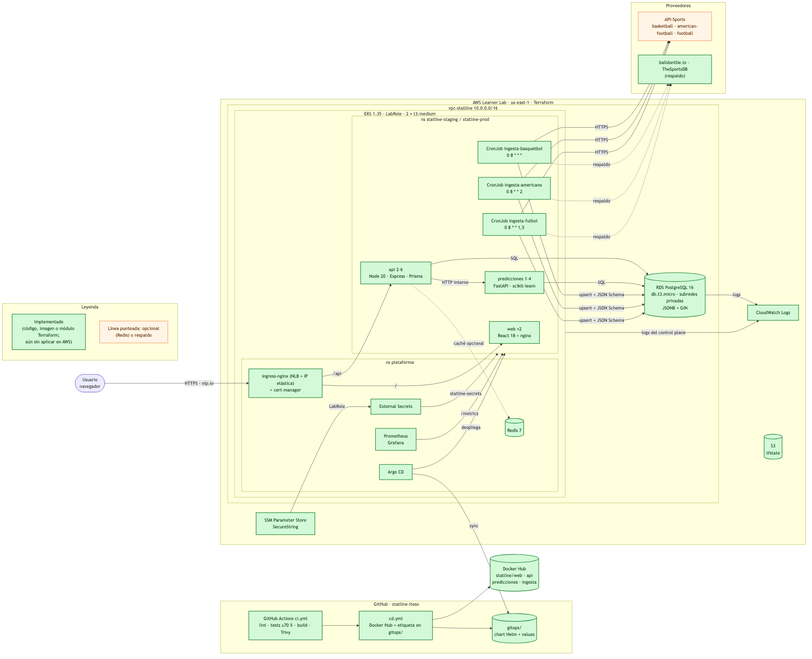

# statline-infra

Infrastructure for **StatLine**, a web platform for unified sports statistics and performance forecasts across three leagues: **NBA** (basketball), **NFL** (American football) and **Liga MX** (football). Scheduled jobs pull games and box scores from API-Sports, a REST API serves comparisons and standings, and a Python service produces match-outcome probabilities and player projections.

This repo holds:
- **Terraform** for every Azure resource: `bootstrap` (state storage) and `principal` (network, AKS, PostgreSQL, Key Vault, Log Analytics, ingress IP, platform Helm releases; DNS when a domain is set)
- the `make` targets that bootstrap state, plan and apply
- a **k3d** setup for testing the Kubernetes manifests locally
- the **GitOps** charts (`gitops/charts/statline`, `gitops/charts/redis`) and the Argo CD applications that deploy the four images
- the project-wide docs: architecture, data model, API design, backlog and pending work

The app itself lives in [`statline-backend`](https://github.com/statline-iteso/statline-backend) and [`statline-frontend`](https://github.com/statline-iteso/statline-frontend).

## Proyecto final · ITESO, Otoño 2026

**Proyecto:** StatLine — Plataforma de Estadísticas y Pronósticos Deportivos Multideporte

| Integrante | Rol |
|---|---|
| Juan Pablo González | Backend, frontend y cimientos (primera mitad) |
| Ian Rodríguez | Infraestructura, predicciones y despliegue (segunda mitad) |

### Caso de uso de punta a punta

Cada mañana el CronJob `ingesta-basquetbol` consulta API-Sports, normaliza los partidos y las líneas de caja de la NBA, valida cada línea contra su JSON Schema y la guarda en PostgreSQL (JSONB con índice GIN). Un usuario inicia sesión en la web, revisa la tabla de posiciones, busca a un jugador y consulta su ficha. Antes de la jornada, el servicio de predicciones calcula las probabilidades de cada partido con el modelo activo registrado en `ModeloPrediccion`.



Verde: implementado. Gris punteado: pendiente para la segunda mitad. Fuente editable en [`docs/solucion.mmd`](docs/solucion.mmd) (`make diagram`).

### Repositorios

| Repo | Contiene |
|---|---|
| [statline-infra](https://github.com/statline-iteso/statline-infra) (este) | Terraform, k3d, *(pendiente)* chart GitOps y Argo CD, documentación del proyecto |
| [statline-backend](https://github.com/statline-iteso/statline-backend) | `api` (Node 20 + Express + Prisma), `ingesta` y `predicciones` (Python 3.12), JSON Schemas, sus `Dockerfile` |
| [statline-frontend](https://github.com/statline-iteso/statline-frontend) | SPA en React 18 + Vite + Tailwind que consume la API |

### Entregables

| # | Entregable | Dónde |
|---|---|---|
| 1 | Diagrama de la solución | [docs/solucion.png](docs/solucion.png) |
| 2 | Modelo de datos | [docs/modelo-datos.md](docs/modelo-datos.md) |
| 3 | Diseño de la API | [docs/api.md](docs/api.md) |
| 4 | Código fuente | Backend: [statline-backend](https://github.com/statline-iteso/statline-backend) (`services/`, `schemas/`). Frontend: [statline-frontend](https://github.com/statline-iteso/statline-frontend). Infraestructura: [`terraform/`](terraform), [`k3d/`](k3d), [`scripts/`](scripts) |
| 5 | Backlog y tablero | [docs/BACKLOG.md](docs/BACKLOG.md) · [GitHub Project](https://github.com/orgs/statline-iteso/projects) |
| 6 | Pendientes | [docs/pendientes.md](docs/pendientes.md) |

### Avance

32 de 61 issues (144 de 277 puntos) están terminados: cimientos, los módulos de Terraform `bootstrap`, `red`, `aks` y `datos`, la ingesta de NBA de punta a punta, la API con autenticación y el catálogo, el esqueleto de predicciones, las vistas base del frontend y el CI de los tres repos. El resto está en [docs/pendientes.md](docs/pendientes.md), cada punto con su issue.

### Cómo correrlo

| Situación | Comandos | Tiempo |
|---|---|---|
| Suscripción nueva (una vez) | `az login` → `make bootstrap` | ~3 min |
| Infraestructura en Azure | `cp terraform/principal/terraform.tfvars.example terraform/principal/principal.auto.tfvars` → `make plan` → `make apply` | ~15 min |
| Al terminar | `make destroy` (AKS + PostgreSQL consumen crédito de Azure for Students) | ~10 min |
| Sin Azure | backend: `docker compose up -d --wait` y `pnpm --filter @statline/api dev` en su repo; frontend: `pnpm dev` | 2 min |
| Clúster local | `make k3d-up` / `make k3d-down` | ~2 min |

### Documentación de planeación

Roadmap por área y bitácora del proyecto: [resumen](docs/planning/README.md) · [infra](docs/planning/infra-plan.md) · [backend](docs/planning/back-plan.md) · [frontend](docs/planning/front-plan.md) · [changelog](docs/planning/changelog.md).

## Docs

| Read | For |
|---|---|
| [AGENTS.md](AGENTS.md) | Start here: scope, Azure for Students constraints, stack, commands, repo layout, rules |
| [docs/ARCHITECTURE.md](docs/ARCHITECTURE.md) | Every Azure resource, the cluster layout, CI/CD and GitOps flow, branch strategy |
| [docs/CONVENTIONS.md](docs/CONVENTIONS.md) | How Terraform, manifests, scripts and workflows are written |
| [docs/DECISIONS.md](docs/DECISIONS.md) | What we decided and why, known limitations, future work |
| [docs/BACKLOG.md](docs/BACKLOG.md) | Every issue (61), by epic and sprint |

## Prerequisites

- An **Azure for Students** subscription and the **Azure CLI** (`az login`)
- **[mise](https://mise.jdx.dev)**, which installs every other CLI at the pinned version (see [Tooling](#tooling))
- **Docker**, for k3d and for building images
- **[GitHub CLI](https://cli.github.com)** (`gh`), with access to the three repos

## Tooling

All CLI versions are pinned in [`mise.toml`](mise.toml): terraform, tflint, kubectl, helm, k3d, azure-cli, shellcheck and pre-commit.

```bash
curl https://mise.run | sh        # or: brew install mise / winget install jdx.mise
mise install                      # installs every pinned tool for this repo
pre-commit install                # git hooks: fmt, validate, tflint, shellcheck
make help                         # every target
```

## First time on a subscription

```bash
az login
az account set --subscription "<Azure for Students>"
make bootstrap                    # resource group + storage account for remote state (local state)
                                  # then writes terraform/principal/backend.hcl
cp terraform/principal/terraform.tfvars.example terraform/principal/principal.auto.tfvars
make apply-aks                    # step 1: only the AKS cluster (the kubernetes/helm providers need it)
make plan                         # step 2: everything else (namespaces, ingress IP, platform charts)
make apply                        # asks before applying
az aks get-credentials -g rg-statline -n aks-statline
terraform -chdir=terraform/principal output ingress_public_ip
terraform -chdir=terraform/principal output -raw grafana_admin_password   # Grafana, user admin
```

**Two-step first apply.** The `kubernetes` and `helm` providers read the cluster's kubeconfig from
`module.aks`. On a cluster that does not exist yet those values are unknown, so a single
`make plan` can fail on the providers. `make apply-aks` creates the cluster alone; after that every
plan is normal. The same applies when the cluster is recreated from scratch (decision D-24).

**Domain (optional).** Set `dominio` in `principal.auto.tfvars` when the team decides it. Then Terraform
creates the DNS zone and the `@` and `staging` A records, and `terraform output dns_name_servers` lists
the name servers to delegate at the registrar. Without `dominio` no zone is created.

**Argo CD UI** (no public Ingress yet): `kubectl -n plataforma port-forward svc/argo-cd-argocd-server 8080:80`.

> [!WARNING]
> **Run `make destroy` when you are done for the day** unless the cluster must stay up. AKS nodes (2× Standard_B2s), the load balancer and PostgreSQL bill by the hour against the student credit. The bootstrap storage account stays; it costs cents.

### Recovering the bootstrap state

The `bootstrap` stack keeps its state locally (`terraform/bootstrap/terraform.tfstate`, gitignored) because it creates the storage account every other stack stores its state in. If that file is lost, **don't** run `make bootstrap` again; import the existing resources:

```bash
cd terraform/bootstrap && terraform init
terraform import random_string.suffix <suffix>             # the 6 chars after "ststatlinetf"
terraform import azurerm_resource_group.tfstate /subscriptions/<sub>/resourceGroups/rg-statline-tfstate
terraform import azurerm_storage_account.tfstate /subscriptions/<sub>/resourceGroups/rg-statline-tfstate/providers/Microsoft.Storage/storageAccounts/<name>
terraform plan                                              # should say "No changes" (or only the role assignment)
cd ../.. && make backend-config
```
