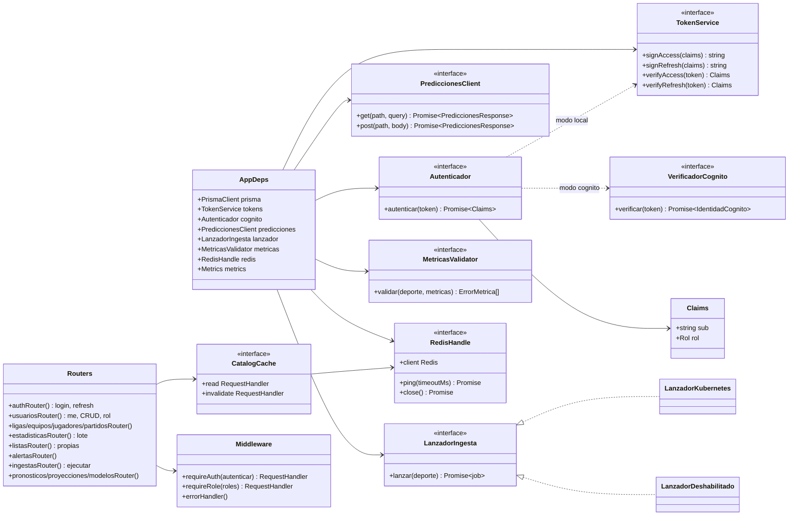
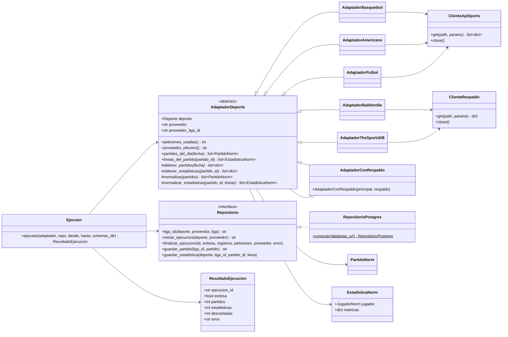
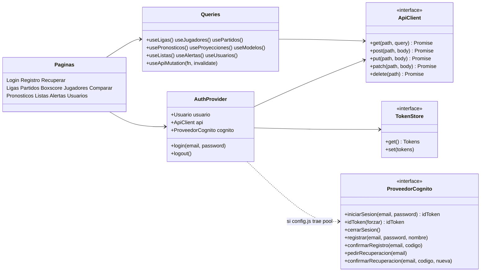

# Componentes y sus métodos

Diagramas de clases de los cuatro componentes de StatLine, tomados del código en `develop` (v1.2.0). Los servicios usan interfaces y funciones fábrica más que herencia; cada diagrama muestra las interfaces que cruzan capas, sus implementaciones y los métodos públicos. El modelo de datos (tablas y relaciones) está en [modelo-datos.md](modelo-datos.md) y las rutas de la API en [api.md](api.md).

| Componente | Repo | Lenguaje | Responsabilidad |
|---|---|---|---|
| web | statline-frontend | React 18 · TypeScript | SPA: catálogo, boxscores, comparación, pronósticos, listas, alertas, usuarios |
| api | statline-backend `services/api` | Node 20 · Express · Prisma | REST `/api/*`, autenticación (Cognito o local), roles, caché, límites de peticiones |
| predicciones | statline-backend `services/predicciones` | Python 3.12 · FastAPI · scikit-learn | Entrena, versiona y activa modelos; genera pronósticos y proyecciones |
| ingesta | statline-backend `services/ingesta` | Python 3.12 · httpx · psycopg | CronJobs por deporte: descarga, normaliza, valida contra JSON Schema y guarda |

## api (Node · Express)

`createApp(deps)` es la raíz de composición: recibe todas las dependencias (interfaces) y monta los routers. `server.ts` pasa las implementaciones reales y las pruebas pasan dobles.



- **Autenticación:** `requireAuth` convierte el bearer en `Claims {sub, rol}`. En modo `cognito` el `Autenticador` verifica el ID token de Cognito (`aws-jwt-verify`) y liga o crea el `Usuario` (backend D-41); en modo `local` envuelve `TokenService.verifyAccess`.
- **Roles:** `requireRole("ADMIN")` protege escrituras del catálogo, ingestas, activación de modelos y la gestión de usuarios.
- **Datos:** Prisma (`schema.prisma`) es dueño del esquema; las migraciones corren en un initContainer.

## ingesta (Python)

Un adaptador por deporte implementa `AdaptadorDeporte`; `AdaptadorConRespaldo` cae al proveedor gratuito cuando API-Sports no responde o el plan no alcanza. `ejecutar()` recorre los días, valida cada línea contra `schemas/<deporte>.schema.json` y guarda con un `Repositorio`.



## predicciones (Python · FastAPI)

Dos tipos de modelo: `RESULTADO_PARTIDO` (regresión logística sobre la forma de los equipos, más Poisson para el marcador esperado) y `PROYECCION_JUGADOR` (gradient boosting por métrica). Cada entrenamiento se registra versionado en `ModeloPrediccion` y solo se activa si supera su baseline.

```mermaid
classDiagram
    direction LR
    class API_FastAPI {
        +POST /modelos/reentrenar
        +POST /modelos/{id}/activar
        +POST /pronosticos/generar
        +POST /proyecciones/generar
        +GET /precision
    }
    class Servicio {
        +reentrenar(conn, body) dict
        +activar(conn, modelo_id) dict
        +generar_pronosticos(conn, body, cache_dir) dict
        +generar_proyecciones(conn, body, cache_dir) dict
        +precision(conn, deporte, tipo) dict
    }
    class Registro {
        +entrenar_y_registrar(conn, deporte, tipo) dict
        +registrar(conn, resultado, sintetico) RegistroModelo
        +decidir_activacion(supera_baseline, metrica, metrica_activa) tuple
        +activar(conn, modelo_id)
        +cargar_activo(conn, deporte, tipo, cache_dir) ModeloCargado
        +serializar(bundle) bytes
    }
    class ResultadoEntrenamiento {
        +Deporte deporte
        +TipoInferencia tipo
        +bundle
        +str nombre_metrica
        +float metrica
        +float baseline
        +int n_train
        +int n_test
        +supera_baseline() bool
    }
    class BundleResultado {
        +clasificador LogisticRegression
        +goles_local PoissonRegressor
        +goles_visita PoissonRegressor
        +features tuple
        +clases tuple
        +int ventana
    }
    class BundleJugador {
        +modelos dict~objetivo, GradientBoosting~
        +objetivos tuple
        +features tuple
        +int ventana
    }
    class ModelosResultado {
        +entrenar_resultado(deporte, partidos) ResultadoEntrenamiento
        +predecir_resultado(bundle, features) DataFrame
    }
    class ModelosJugador {
        +entrenar_jugador(deporte, lineas) ResultadoEntrenamiento
        +predecir_jugador(bundle, features) DataFrame
    }
    class Features {
        +features_partidos(partidos, ventana) DataFrame
        +features_jugadores(historial, consultas, objetivos, ventana) DataFrame
    }
    class Datos {
        +cargar_partidos(conn, deporte) DataFrame
        +cargar_lineas(conn, deporte) DataFrame
        +reemplazar_pronosticos(conn, filas)
        +reemplazar_proyecciones(conn, filas)
    }
    API_FastAPI --> Servicio
    Servicio --> Registro
    Servicio --> Datos
    Registro --> ModelosResultado
    Registro --> ModelosJugador
    Registro --> ResultadoEntrenamiento
    ModelosResultado --> BundleResultado
    ModelosJugador --> BundleJugador
    ModelosResultado --> Features
    ModelosJugador --> Features
```

## web (React)


