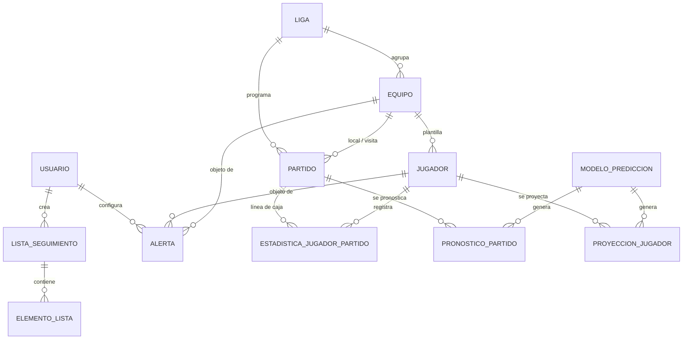

# Modelo de datos

Entregable 2. La fuente de verdad es [`services/api/prisma/schema.prisma`](https://github.com/statline-iteso/statline-backend/blob/develop/services/api/prisma/schema.prisma) en el backend; Prisma Migrate crea las tablas y la ingesta (Python) escribe en ellas con SQL usando los mismos nombres en snake_case. La base corre en PostgreSQL 16 Flexible Server ([ARCHITECTURE §3](ARCHITECTURE.md#3-modules-and-resources)).

## Por qué PostgreSQL con JSONB

| | PostgreSQL + JSONB (elegido) | Tablas por deporte | Base documental |
|---|---|---|---|
| Métricas heterogéneas | Una columna `metricas` JSONB por línea de caja, validada contra el JSON Schema del deporte | Una tabla de estadísticas por deporte; cada consulta transversal se vuelve un `UNION` | Natural, pero pierde integridad referencial con partidos y jugadores |
| Integridad | Llaves foráneas y únicas en columnas comunes (partido, jugador, equipo, minutos) | Igual | A mano en la aplicación |
| Consultas | `metricas @> '{"puntos": 30}'` usa el índice GIN `jsonb_path_ops`; agregaciones con `(metricas->>'puntos')::int` | SQL simple pero triplicado | Agregaciones fuera del motor relacional |
| Operación | Un solo motor gestionado en Azure | Igual | Otro servicio que pagar y operar |

**Desventaja aceptada:** el motor no valida la forma del JSONB; esa validación vive en la ingesta (JSON Schema estricto antes de cada insert, issue SL-15).

## Diagrama entidad-relación

`EJECUCION_INGESTA` no tiene relaciones: es la bitácora de cada corrida de los CronJob.

## Entidades

Todas las llaves primarias son UUID. Las fechas se guardan en UTC (`timestamp(3)`).

| # | Tabla | Columnas principales | Llaves e índices | Origen |
|---|---|---|---|---|
| 1 | `usuario` | `email`, `nombre`, `password_hash` (bcrypt), `rol` (ADMIN · ANALISTA · USUARIO) | `email` único | Alta manual (`POST /api/usuarios`) |
| 2 | `liga` | `nombre`, `deporte`, `pais`, `temporada`, `proveedor`, `proveedor_liga_id`, `activa` | único (`proveedor`, `proveedor_liga_id`, `temporada`) · índice `deporte` | Semilla + ingesta |
| 3 | `equipo` | `liga_id`, `nombre`, `abreviatura`, `conferencia`, `ciudad`, `logo_url`, `forma_reciente`, `proveedor_id` | único (`liga_id`, `proveedor_id`) | Ingesta |
| 4 | `jugador` | `equipo_id`, `deporte`, `nombre`, `posicion`, `numero`, `estatus` (DISPONIBLE · DUDA · LESIONADO · SUSPENDIDO), `proveedor_id` | único (`deporte`, `proveedor_id`) · índice `nombre` | Ingesta |
| 5 | `partido` | `liga_id`, `local_id`, `visita_id`, `fecha`, `jornada`, `temporada`, `estatus`, `marcador_local`, `marcador_visita`, `proveedor_id` | único (`liga_id`, `proveedor_id`) · índices `fecha`, (`liga_id`, `jornada`) | Ingesta |
| 6 | `estadistica_jugador_partido` | `partido_id`, `jugador_id`, `equipo_id`, `deporte`, `minutos`, **`metricas` JSONB** | único (`partido_id`, `jugador_id`) · **GIN `jsonb_path_ops` sobre `metricas`** | Ingesta |
| 7 | `lista_seguimiento` + `elemento_lista` | `usuario_id`, `nombre`; elementos: `tipo` (JUGADOR · EQUIPO), `ref_id` | único (`lista_id`, `tipo`, `ref_id`) | Alta manual |
| 8 | `pronostico_partido` | `partido_id`, `modelo_id`, `prob_local`, `prob_empate`, `prob_visita`, `marcador_esperado_local`, `marcador_esperado_visita` | índice `partido_id` | Modelo |
| 9 | `proyeccion_jugador` | `jugador_id`, `partido_id`, `modelo_id`, `metricas` JSONB | índice (`jugador_id`, `partido_id`) | Modelo |
| 10 | `modelo_prediccion` | `deporte`, `tipo` (RESULTADO_PARTIDO · PROYECCION_JUGADOR), `version`, `artefacto_uri`, `nombre_metrica`, `metrica_error`, `activo` | único (`deporte`, `tipo`, `version`) · índice (`deporte`, `tipo`, `activo`) | Entrenamiento |
| 11 | `alerta` | `usuario_id`, `tipo` (LESION · UMBRAL · INICIO_PARTIDO), `jugador_id`, `equipo_id`, `condicion` JSONB, `activa`, `ultima_disparada` | índice `usuario_id` | Alta manual |
| 12 | `ejecucion_ingesta` | `deporte`, `proveedor`, `estatus` (EN_CURSO · EXITOSA · FALLIDA), `iniciada_en`, `finalizada_en`, `registros_procesados`, `peticiones_usadas`, `error` | índice (`deporte`, `iniciada_en`) | Sistema |

## Métricas por deporte (JSONB)

Los esquemas están en [`schemas/`](https://github.com/statline-iteso/statline-backend/tree/develop/schemas) del backend (JSON Schema 2020-12, `additionalProperties: false`).

| Deporte | Requeridas | Ejemplo |
|---|---|---|
| `BASQUETBOL` (NBA) | `puntos`, `rebotes`, `asistencias` | `{"puntos": 31, "rebotes": 14, "asistencias": 11, "triplesAnotados": 2, "triplesIntentados": 4}` |
| `AMERICANO` (NFL) | al menos un grupo: `pase`, `carrera`, `recepcion`, `defensa`, `pateo` | `{"pase": {"completos": 22, "intentos": 31, "yardas": 280, "touchdowns": 2}}` |
| `FUTBOL` (Liga MX) | `goles`, `asistencias` | `{"goles": 1, "asistencias": 0, "tiros": 3, "precisionPases": 87.5}` |

## Gobierno de modelos

Cada algoritmo entrenado se registra como una fila de `modelo_prediccion` con su versión, la ruta del artefacto y la métrica de error validada (`log_loss` para resultado, `mae` para proyecciones). Solo un registro por (`deporte`, `tipo`) tiene `activo = true`; activar otro (`POST /api/modelos/:id/activar`) desactiva el anterior en la misma transacción. Así el ciclo de inferencia no depende del código fuente: cambiar de modelo es un cambio de datos.

## Ciclo de escritura de la ingesta

1. `INSERT ejecucion_ingesta (EN_CURSO)`.
2. Por cada partido del día: upsert de los dos equipos y del partido (marcador y estatus se actualizan).
3. Si el partido está `FINALIZADO`: por cada línea de caja, validar `metricas`, upsert del jugador y de la estadística.
4. `UPDATE ejecucion_ingesta` con `EXITOSA` o `FALLIDA`, registros y peticiones usadas.

Repetir un día es idempotente: las llaves únicas convierten cada insert en update.
